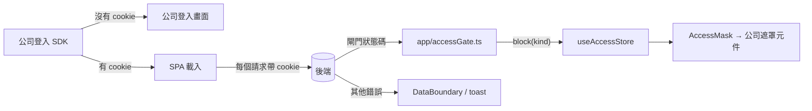

# 登入與存取閘門(Access)

「怎麼進得來、什麼情況被整頁擋住」的寫法。所有專案長一樣、寫法一樣;專案之間只差閘門的狀態碼與公司套件的接法。
決策背景見 [ADR-0017](../adr/0017-access-gate.md);進得來之後「哪一頁、哪顆鈕」的細粒度權限是可選模組
(`permissions.md`,選了才有)。

## 0. 三件事,三個負責人

| 事情                                    | 誰負責                                              | 前端要做什麼                                                         |
| --------------------------------------- | --------------------------------------------------- | -------------------------------------------------------------------- |
| 登入、登出、token 保管與續期            | **公司登入 SDK**:沒有 cookie 就跳轉到公司登入畫面   | **什麼都不做**:沒有登入頁、沒有 session store、不組 header、不判 401 |
| 不在公司網路內 / 沒有這個系統的使用權限 | **後端每支 API 都檢查**,擋下來回固定的狀態碼或 code | `app/accessGate.ts` 一張表 → `AccessMask` 用公司的遮罩元件整頁蓋住   |
| 進得來之後的細粒度權限                  | 後端 + 前端體驗(可選模組 permissions)               | 沒選模組:每頁每鈕都能用;選了:`<RequirePermission>`                   |



## 1. 身分在 cookie,前端不碰

**規則:** `apiClient` 以 `withCredentials: true` 讓瀏覽器自動帶 cookie;前端不保管 token、不組 `Authorization`
header、不解析 JWT、不判斷 401。不走 axios 的請求(`fetch`、串流)也要 `credentials: 'include'`。

**原因:** 公司登入 SDK 負責整個身分生命週期;前端多做一份就是第二個會壞、會過期的來源。
401 代表 SDK 會接手跳轉,前端判了也只是搶在它前面做一件它本來就會做的事。

- ❌ `localStorage.getItem('token')`、`config.headers.Authorization = ...`、`if (httpStatus(error) === 401) navigate(...)`
- ❌ 自己做登入頁、登出按鈕(需要「登出」入口時呼叫 SDK 提供的函式,從 `vendor/companyUi.tsx` 匯出)

## 2. 公司套件只從 `vendor/companyUi.tsx` 進來

**規則:** 公司共用前端套件(登入 SDK、整頁遮罩元件、公司公版外殼、使用者資訊)只在 `src/vendor/companyUi.tsx`
import 一次,再以專案自己的名字匯出(`CompanyAccessBlocked`、需要時 `CompanyShell`、`getCompanyUser`);
其他檔案只 import `@/vendor/companyUi`。套件名稱、版本與 props 的對應在收件時問,寫進 ADR-0021 第 1 節。

**原因:** 套件換版本、改 props 時只改一個檔案;測試以 `vi.mock('@/vendor/companyUi')` 一次換成替身
(`test/companyUiStub.tsx`),不用在每支測試處理 SDK 的初始化。

骨架的 `companyUi.tsx` 自帶一個 `FallbackAccessBlocked`(antd `Result` 的整頁遮罩),讓沒接套件的骨架也能跑;
專案接上公司套件後刪掉它,檔案裡的 `{{COMPANY_UI_PACKAGE}}` 由 `check-placeholders` 擋住沒填的情況。

## 3. 閘門:`app/accessGate.ts` 是唯一判斷處

**規則:** 後端用什麼表示「不在公司網路」「沒有系統權限」,只寫在 `ACCESS_GATE_RULES`(狀態碼、code,或兩者);
`connectAccessGate()` 在 `main.tsx` 呼叫一次,以 response interceptor 判到就 `useAccessStore.block(kind)`,錯誤仍往外拋。
畫面、hook、`describeError` 都不判閘門的狀態碼。

**原因:** 閘門是「整個系統此刻不能用」,不是某個畫面的錯誤;判斷散到各畫面,就會有的畫面遮、有的畫面顯示錯誤卡。
每個專案的後端表示法不同,所以是一張可改的表,不是寫死的 `if`。

```ts
// ✅ src/app/accessGate.ts(骨架預設;依 ADR-0021 第 2 節改)
export const ACCESS_GATE_RULES: readonly AccessGateRule[] = [
  { kind: 'outsideNetwork', status: 423 },
  { kind: 'noAppPermission', status: 403, code: 'NO_APP_PERMISSION' },
];
```

```ts
// ❌ 在 hook 或元件裡
if (httpStatus(error) === 423) setBlocked(true);
```

- 遮罩 `components/common/AccessMask.tsx` 掛在 `AppProviders`(所有頁面與外殼之上),不能關閉;要重新檢查就重新整理。
- 閘門用的狀態碼與一般錯誤重疊時(例如都用 403),**要靠 `code` 區分**:規則同時寫 `status` 與 `code`,
  沒有 `code` 的 403 才走窗格錯誤卡 / toast。收件時跟後端確認。
- 被擋的那個請求照常 reject:窗格會短暫顯示錯誤卡,但已被遮罩蓋住,不用另外處理。

## 4. 外殼:自製是預設,公司公版是選項

**規則:** 骨架的 `AppShell`(header + 側欄 + 內容區)是預設外殼,視覺依 prototype 調 token。
收件時若決定「用公司公版外殼」:在 `vendor/companyUi.tsx` 匯出 `CompanyShell`,`RootLayout` 把 `<AppShell />` 換成
`<CompanyShell>`,側欄資料仍由 `navEntries.tsx` 餵給它(格式依套件,在 `companyUi.tsx` 轉換);`AppShell.tsx`、
`AppHeader.tsx` 刪除。寫進 ADR-0021 第 4 節。

**原因:** 選單、路由、(選了 permissions 時)守衛仍從 `navEntries` 一份長出來;換外殼只換「畫出來的那層」。

## 5. 使用者資訊:需要才接

**規則:** 骨架的 header 不顯示使用者。prototype 有使用者姓名、部門等資訊時,收件時問來源:

| 來源                             | 做法                                                                                                               |
| -------------------------------- | ------------------------------------------------------------------------------------------------------------------ |
| 公司 SDK 提供                    | `vendor/companyUi.tsx` 匯出 `getCompanyUser()`,包成 `hooks/useCompanyUser.ts`(`queryOptions` + `useSuspenseQuery`) |
| 後端一支 API(常見 `getUserInfo`) | 照 `api.md` 加 `types/api/user.ts`、`api/userApi.ts`、`hooks/useUserInfo.ts`;路徑與形狀寫進契約                    |
| 不顯示                           | 什麼都不做                                                                                                         |

顯示位置是 `AppHeader.tsx` 右側工具列(有註解標記的 `<Space>`)。**不把使用者資訊當權限用**:權限走 permissions 模組。

## 6. 測試

- `test/setup.ts` 每個測試前 `useAccessStore.reset()`,並以 `vi.mock('@/vendor/companyUi', () => import('./companyUiStub'))`
  換掉公司套件;替身的遮罩是 `data-testid="access-blocked"`、`data-kind` 是哪一種閘門。
- 測遮罩:讓某支 API 回閘門的狀態碼——沒選 msw 時直接 `useAccessStore.getState().block('outsideNetwork')`
  或換 `httpClient.defaults.adapter`;選了 msw 時 `server.use(http.get('*/api/items', () => new HttpResponse(null, { status: 423 })))`。
- 範本:`components/common/AccessMask.test.tsx`(遮罩出現、interceptor 寫入 store、狀態碼對映)。
- 登入不測:沒有前端程式碼可測。

## 7. 不做的事

- 不做登入頁、登出、session store、refresh token、401 處理:全部是公司 SDK 的事。
- 不在前端判斷「在不在公司網路」(IP、hostname):只看後端回的閘門狀態。
- 不把閘門的狀態碼寫進 `KNOWN_ERROR_CODES` 或 `describeError`:它不是要翻成文案的錯誤,是要整頁遮住的狀態。
- 遮罩不給「重試」或「關閉」:公司的遮罩元件決定使用者能做什麼。
