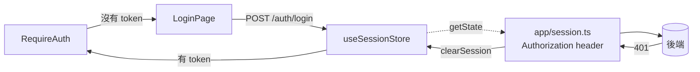

# 登入與 Session

登入頁、登入狀態、登出、401 的處理方式。所有專案長一樣、寫法一樣;專案之間只差「認證方式」那一層。
決策背景見 [ADR-0017](../adr/0017-login-and-session-skeleton.md);權限(登入之後能看什麼)見 [auth.md](./auth.md)。

## 0. 組成

| 落點           | 檔案                                                                                 | 做什麼                                                                                                                                                  |
| -------------- | ------------------------------------------------------------------------------------ | ------------------------------------------------------------------------------------------------------------------------------------------------------- |
| DTO            | `types/api/auth.ts`                                                                  | `LoginRequest`、`LoginResponse`,與公司登入服務逐字一致                                                                                                  |
| 端點           | `api/authApi.ts`                                                                     | `login`、`logout`、`getCurrentUser`                                                                                                                     |
| 登入狀態       | `stores/useSessionStore.ts`                                                          | `accessToken`、`setAccessToken`、`clearSession`;persist 到 `app:session`                                                                                |
| 接上 apiClient | `app/session.ts` 的 `connectSession()`                                               | 每個請求帶 `Authorization: Bearer <token>`;收到 401 就 `clearSession()`                                                                                 |
| 守衛           | `components/auth/RequireAuth.tsx`                                                    | 沒有 session 導到 `ROUTES.login`,記住原本的網址                                                                                                         |
| 登入頁         | `pages/Login/LoginPage.tsx`                                                          | 帳號 / 密碼表單;失敗訊息顯示在表單內;已登入就導回                                                                                                       |
| 寫入 hook      | `hooks/useSessionMutations.ts`                                                       | `useLogin`(成功存 token)、`useLogout`(清 session、清快取)                                                                                               |
| 登出入口       | `components/layouts/UserMenu.tsx`                                                    | header 右側:使用者姓名 + 登出                                                                                                                           |
| 路由           | `app/routes.tsx`                                                                     | `PublicLayout`(登入頁)與 `RequireAuth` 包住的 `RootLayout`(其餘頁面)兩個區域                                                                            |
| 假後端         | 選了 msw:`mocks/handlers.ts`、`mocks/db.ts`;沒選:`test/setup.ts`、`test/fixtures.ts` | msw:`POST /auth/login`、`POST /auth/logout`、`GET /me` 檢查 token,帳密 `MOCK_LOGIN`;沒選:`vi.mock('@/api/authApi')`,`getCurrentUser` 預設回 `TEST_USER` |

## 1. 登入狀態只在 `useSessionStore`

**規則:** token 只存在 `useSessionStore`;讀寫一律透過它的 action。元件不自己讀 localStorage,
不把 token 放進 TanStack Query、URL 或 React state。

**原因:** 它是 client 端的 session 狀態,不是伺服器資料(伺服器資料是 `GET /me`,仍走 `useCurrentUser`)。
只有一個來源,`app/session.ts` 才能保證每個請求帶的都是同一個 token。

- ✅ `const isAuthenticated = useSessionStore(selectIsAuthenticated);`
- ❌ `localStorage.getItem('token')`、`const [token, setToken] = useState(...)`

預設 persist 到 localStorage(重新整理與開新分頁都保留)。要改成關閉分頁就登出,在 store 的 `persist`
加 `storage: createJSONStorage(() => sessionStorage)`,並寫 ADR。

## 2. token 怎麼送、401 怎麼接:`app/session.ts`

**規則:** `connectSession()` 在 `main.tsx` 呼叫一次(測試由 `test/setup.ts` 呼叫)。它做兩件事:
`setAuthHeaderProvider` 讀 store 組 header;response interceptor 收到 401 就 `clearSession()`。
其他地方不註冊認證相關的 interceptor,不手動加 `Authorization`。

**原因:** 401 代表「這個 token 已經無效」,不是某個畫面的錯誤;清掉 session 之後,
`RequireAuth` 會自動把使用者送回登入頁,每個畫面不用各自處理。

- ❌ 在 hook 裡 `if (httpStatus(error) === 401) navigate('/login')`。

## 3. 守衛:`RequireAuth`

**規則:** 需要登入的頁面都放在 `app/routes.tsx` 的 `RequireAuth` 區域底下(骨架的 `RootLayout`
已經在裡面)。不需要登入的頁面放 `PublicLayout` 區域。頁面元件不自己檢查登入。

`RequireAuth` 導向登入頁時以 `state.from` 記住原本的網址;`LoginPage` 登入成功後讀它導回,
沒有就回 `ROUTES.home`。

## 4. 登入頁

**規則:** 登入頁的版面、欄位、錯誤呈現由骨架決定,專案不重做:

- 置中的 `Card`,上方是系統名稱(`APP_NAME`,選了 i18n 時是 `t.app.name`)與副標;欄位是帳號、密碼;按鈕 `block`。
- 登入失敗顯示在表單上方的 `Alert`(`role="alert"`),文案由 `describeActionError` 依後端 `code`
  決定(`describeActionError`);`INVALID_CREDENTIALS` 已在 `KNOWN_ERROR_CODES`。**不用 toast**(`useLogin` 已覆寫 `onError`)。
- 已登入的使用者進到 `/login` 直接導回。
- prototype 畫了登入頁時,只調整 token(色票、字型)與文案,不改結構;確實需要不同結構(例如
  加公司 logo、說明文字)時改骨架,讓所有專案一起變。

## 5. 登出

**規則:** 登出只從 `UserMenu` 觸發,走 `useLogout`:呼叫 `POST /auth/logout`(失敗也視為已登出),
`clearSession()`,`queryClient.clear()`。

**原因:** 不清快取的話,下一個登入的人會短暫看到上一個人的 `GET /me` 與資料。

## 6. 換認證方式

專案的認證方式在收件時決定並寫 ADR(範本 `templates/adr-auth-mode.md`)。三種常見情況:

| 方式                                         | 要改的檔案                                                                                                                                                  | 不動的檔案                                                      |
| -------------------------------------------- | ----------------------------------------------------------------------------------------------------------------------------------------------------------- | --------------------------------------------------------------- |
| 帳密登入,回 Bearer token(骨架預設)           | `types/api/auth.ts`、`api/authApi.ts`(選了 msw 還有 `mocks/handlers.ts`)的欄位名與路徑對齊公司登入服務                                                      | store、`app/session.ts`、`RequireAuth`、`LoginPage`、`UserMenu` |
| SSO 跳轉(OIDC / SAML),callback 帶 token 回來 | `LoginPage` 的表單換成「以公司帳號登入」按鈕導向 IdP;新增 `pages/AuthCallback/` 讀取 token 後 `setAccessToken`,放在 `PublicLayout` 區域;`useLogin` 改為導向 | store、`app/session.ts`、`RequireAuth`、`UserMenu`              |
| Gateway / Cookie(前端沒有 token)             | `app/session.ts` 不帶 header,401 時改為 `window.location.assign(<gateway 登入網址>)`;`RequireAuth` 改以 `useCurrentUser` 成功與否判斷;`LoginPage` 可移除    | `UserMenu`、`useLogout`(改呼叫 gateway 的登出)                  |

不論哪一種,**401 的處理只在 `app/session.ts`,登入狀態只在 `useSessionStore`**,這兩點不變。

## 7. 測試

- `test/setup.ts` 讓每個測試**預設已登入**(`accessToken` 為 `MOCK_ACCESS_TOKEN`)。
  要測未登入:`useSessionStore.setState({ accessToken: null })`。
- 模擬登入:`MOCK_LOGIN` 的帳密;錯誤帳密回 `401 INVALID_CREDENTIALS`。
- 模擬 token 失效:`server.use(http.get('*/api/items', () => HttpResponse.json({ code: 'UNAUTHORIZED' }, { status: 401 })))`,
  斷言網址變成 `/login`。
- 範本:`components/auth/RequireAuth.test.tsx`、`pages/Login/LoginPage.test.tsx`、`components/layouts/UserMenu.test.tsx`。

## 8. 不做的事

- 不在前端解析 JWT 的內容來判斷權限或到期:權限來自 `GET /me`,到期由後端回 401。
- 不自動刷新 token:需要 refresh token 時寫 ADR,並把刷新邏輯放在 `app/session.ts`,仍只有一處。
- 不在 `.env` 放帳密或 token。
