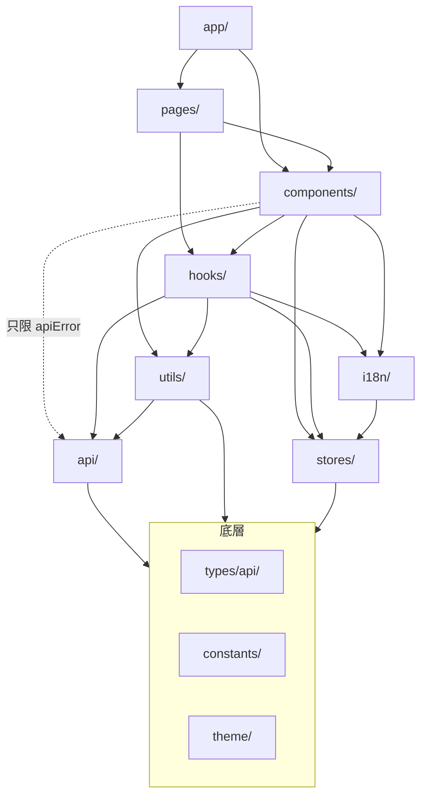

# 專案結構

> 依「層」放,不依「功能」放。決策理由見 [ADR-0002](../adr/0002-layered-directory-structure.md),
> lint 強制方式見 [ADR-0013](../adr/0013-lint-enforces-layer-boundaries.md)。

## 1. 資料夾:放什麼、不放什麼

| 資料夾                 | 放什麼                                                                                                                          | 不放什麼                            |
| ---------------------- | ------------------------------------------------------------------------------------------------------------------------------- | ----------------------------------- |
| `api/`                 | `apiClient.ts`、`apiError.ts`、`apiPath.ts`、`expectArray.ts`;每個資源一個 endpoint module(`itemApi.ts`)                        | TanStack Query、React、狀態、文案   |
| `types/api/`           | 與後端 DTO 逐字一致的型別(`item.ts`、`error.ts`)                                                                                | 前端自己的 view model、元件 props   |
| `hooks/`               | 資料 hook(`queryOptions` + query / mutation)、跨元件共用的 UI hook(`useDebouncedValue`、`useConfirmDestructive`)                | JSX、只被一個元件用的邏輯           |
| `stores/`              | Zustand store,只放全域 UI 狀態(`useThemeStore`)與登入 token(`useSessionStore`)                                                  | 任何來自 API 的資料                 |
| `components/<domain>/` | UI 元件,依業務 domain 分子資料夾(`items/`);共用零件在 `common/`,外殼在 `layouts/`,登入與權限守衛在 `auth/`                      | 直接呼叫 API、路由設定              |
| `pages/<Name>/`        | 路由頁面 `<Name>Page.tsx` 與它的頁面測試;只組裝元件、放 `DataBoundary`、讀 URL state                                            | 業務邏輯、資料轉換、API 呼叫        |
| `app/`                 | 啟動組裝:`App.tsx`、`providers.tsx`、`queryClient.ts`、`router.tsx`、`routes.tsx`、`navPages.tsx`、`subPages.tsx`、`session.ts` | 業務元件                            |
| `constants/`           | 全域常數的唯一來源:`routes.ts`、`permissions.ts`、`storage.ts`                                                                  | 文案(進 `i18n/`)、色碼(進 `theme/`) |
| `i18n/`                | 字典 `zhTW.ts`(形狀來源)、`en.ts`、`useTranslations.ts`、`languages.ts`(語言名稱,刻意不進字典)、守門測試                        | 業務邏輯                            |
| `theme/`               | `tokens.ts`(唯一色票來源)、`antdTheme.ts`、`cssVars.ts`                                                                         | 元件樣式(用 CSS Modules 跟著元件)   |
| `utils/`               | 純函式(`describeError.ts`),不依賴 React                                                                                         | hook、有副作用的程式                |
| `mocks/`               | MSW `handlers.ts`(`pendingHandlers` / `shippedHandlers`)、記憶體資料 `db.ts`、`browser.ts`(開發期)、`server.ts`(測試)           | 正式程式會 import 的任何東西        |
| `test/`                | `setup.ts`、`renderApp.tsx` 等測試工具                                                                                          | 測試案例本身(與被測檔案同目錄)      |

**原因**:同一層的檔案遵守同一套規則(例如 `hooks/` 一律不含 JSX),reviewer 看路徑就知道該檢查什麼;
依賴方向可以用 lint 強制。

- ✅ `src/hooks/useItems.ts`、`src/components/items/ItemTable.tsx`、`src/pages/Items/ItemsPage.tsx`
- ❌ `src/features/items/{api,hooks,components}/…`(依功能分資料夾)
- ❌ 在 `pages/Items/` 底下放 `ItemsTable.tsx` 子元件(元件一律進 `components/<domain>/`)

### 檔案放置細則

- 測試與被測檔案放同一資料夾:`ItemsPage.tsx` 旁邊是 `ItemsPage.test.tsx`。
- 元件的樣式與元件同資料夾:`AppShell.tsx` + `AppShell.module.css`。
- 一個資源的讀取與寫入 hook 分兩檔:`useItems.ts`(query)、`useItemMutations.ts`(mutation)。

## 2. 依賴方向

箭頭表示「可以 import」。反方向一律禁止。



(`app/` 與 `components/` 也可直接 import 底層;圖中省略這些箭頭以保持可讀。)

重點:

- 元件與頁面**不 import `@/api/*`**,只透過 hooks 取資料;唯一例外是 `@/api/apiError` 的判斷函式。
- 元件、頁面、hooks 都**不 import `axios`**。
- `hooks/` 不 import `components/`、`pages/`、`app/`。
- `stores/` 不 import `api/`、`hooks/`、`components/`、`pages/`。
- `api/`、`utils/`、`types/`、`constants/` 不反向 import `hooks/`、`stores/`、`components/`、`pages/`、`app/`。
- `i18n/`、`theme/` 只依賴 `stores/`、`types/`、`constants/`;不 import `api/`、`hooks/`、`components/`、`pages/`、`app/`。
- **任何一層都不 import `@/mocks/*`**;只有 `main.tsx` 的開發期開關、`test/` 與測試檔可以。
- 測試檔(`*.test.ts(x)`)不套用分層規則:測試需要 import mocks 與跨層組裝。

**強制**:ESLint `no-restricted-imports`(`eslint.config.js` 的 `LAYER_RULES` 與 `NO_MOCKS`;`TEST_FILES` 排除測試檔)。

```ts
// ❌ src/components/items/ItemTable.tsx
import { listItems } from '@/api/itemApi'; // lint error:元件與頁面不直接呼叫 API

// ✅
import { useItems } from '@/hooks/useItems';
```

## 3. Import 路徑

**規則**:跨資料夾一律 `@/`(指向 `src/`);同資料夾用 `./`;**禁止 `../`**。不新增其他 alias。

**原因**:`../` 會讓分層規則被相對路徑繞過;單一 alias 讓搜尋與搬檔簡單。

- ✅ `import { useItems } from '@/hooks/useItems';`、`import styles from './AppShell.module.css';`
- ❌ `import { useItems } from '../../hooks/useItems';`

**強制**:ESLint `no-restricted-imports`(`NO_PARENT_RELATIVE`);alias 定義在 `vite.config.ts` 與 `tsconfig.*.json`。
import 的排序交給 `simple-import-sort`,不手動排。

## 4. 加一個新功能會碰到哪些資料夾

以新增「Item 詳細頁」為例,依序:

1. **規格 `docs/spec/` 或後端契約** — 確認端點(路徑、request / response、錯誤 code);沒有契約就依規格提草案。
2. **`types/api/item.ts`** — 補上 DTO 型別,欄位名與後端逐字一致([api.md](./api.md))。
3. **`api/itemApi.ts`** — 新增 endpoint 函式,路徑用 `apiPath()`,清單用 `expectArray()`。
4. **`hooks/`** — 新增 `queryOptions` 與 `useItem(id)`;寫入加在 `useItemMutations.ts`
   ([data-fetching.md](./data-fetching.md))。
5. **`components/items/`** — 新增 UI 元件,資料從 hook 拿([components.md](./components.md))。
6. **`pages/ItemDetail/ItemDetailPage.tsx`** — 組裝元件、包 `DataBoundary`、讀 URL 參數。
7. **`constants/routes.ts` → `components/layouts/navEntries.tsx` → `app/navPages.tsx`** — 加路徑、
   選單入口與頁面對應;不在選單上的子頁直接加在 `app/routes.tsx`([routing.md](./routing.md))。
   需要權限時先在 `constants/permissions.ts` 加一列([auth.md](./auth.md))。
8. **`i18n/zhTW.ts`、`i18n/en.ts`** — 所有文案、aria-label、新錯誤 code 的文案;
   新錯誤 code 也要加進 `types/api/error.ts` 的 `KNOWN_ERROR_CODES`([i18n.md](./i18n.md))。
9. **`mocks/handlers.ts`、`mocks/db.ts`** — 新端點的 handler 加進 `pendingHandlers`,形狀與契約逐字一致;
   後端上線後搬到 `shippedHandlers`
   ([mocking.md](./mocking.md))。
10. **測試** — 頁面測試放 `pages/ItemDetail/ItemDetailPage.test.tsx`,用 `renderApp()` 從網址進入
    ([testing.md](./testing.md))。

最後跑 `npm run lint`、`npm run typecheck`、`npm test`、`npm run build`。
