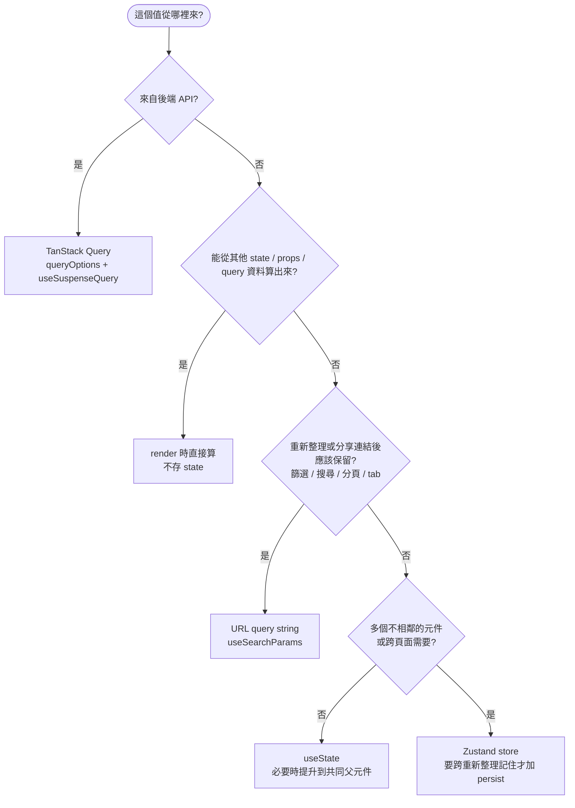

# 狀態管理

> 決策理由見 [ADR-0004](../adr/0004-server-state-vs-ui-state.md)。

## 1. 四種狀態,四個位置

| 狀態                                                          | 放哪裡           | 骨架範例                                              |
| ------------------------------------------------------------- | ---------------- | ----------------------------------------------------- |
| 伺服器資料(API 回來的任何東西)                                | TanStack Query   | `useItems()`、`useCurrentUser()`                      |
| 可分享、重新整理要保留的檢視條件(篩選、搜尋、分頁、tab、排序) | URL query string | `ItemsPage` 的 `?q=`                                  |
| 跨頁面、跨元件的全域 UI 狀態                                  | Zustand          | `useThemeStore`、`useLayoutStore`、`useLanguageStore` |
| 只有一個元件(或一對父子)在用的 UI 狀態                        | `useState`       | `ItemsPage` 的 `isCreateOpen`                         |

表單欄位值由 antd `Form` 自己管理,不另外放 state。

## 2. 決策樹



## 3. 伺服器資料只用 TanStack Query

**規則**:API 回來的資料**絕不**寫進 Zustand 或 `useState`。要用就呼叫資料 hook;要改就用 mutation + invalidate。

**原因**:複製一份就有兩個真相。快取失效、重抓、錯誤與 loading 狀態 TanStack Query 都已處理,
放進 store 等於自己重寫一次而且一定會不同步。

```ts
// ❌ src/stores/useItemStore.ts
export const useItemStore = create<ItemState>()((set) => ({
  items: [],
  load: async () => set({ items: await listItems() }),
}));
```

```ts
// ✅ src/hooks/useItems.ts
export const useItems = () => useSuspenseQuery(itemsQuery).data;
```

**強制**:ESLint `no-restricted-imports`——`src/stores/**` 不可 import `@/api/*`、`@/hooks/*`
(`eslint.config.js` 的 `LAYER_RULES`)。

## 4. 衍生值不存 state

**規則**:能從現有資料算出來的值,render 時直接算。

- ✅ `ItemTable` 中 `const visibleItems = normalizedKeyword ? items.filter(...) : items;`
- ❌ `useState` 存 `visibleItems`,再用 `useEffect` 同步

React Compiler 會自動快取計算結果,不需要 `useMemo`([components.md](./components.md))。

## 5. 檢視條件放 URL

**規則**:篩選、搜尋字、分頁、目前 tab、排序放 URL query string,用 react-router 的 `useSearchParams`。
輸入框每打一字就更新 URL 時用 `{ replace: true }`,避免塞爆瀏覽器上一頁。

**原因**:重新整理不會遺失、可以把連結貼給同事、上一頁 / 下一頁行為正確。

```tsx
// ✅ src/pages/Items/ItemsPage.tsx
const keyword = searchParams.get('q') ?? '';
// ...
onChange={(event) => setSearchParams(event.target.value ? { q: event.target.value } : {}, { replace: true })}
```

- ❌ `const [keyword, setKeyword] = useState('')` 存搜尋字——重新整理就消失,也無法分享。

更多 URL state 寫法見 [routing.md](./routing.md)。

## 6. Zustand:只放全域 UI 狀態

**規則**

- 一個關注點一個 store,檔名 `stores/use<Name>Store.ts`。
- state 與 action 寫在同一個 `interface <Name>State`。
- 一律包 `devtools`(最外層)並給 `name`;每個 `set` 帶 action 名稱(第三個參數)。
- 需要跨重新整理記住的才加 `persist`,storage key 一律取自 `constants/storage.ts`。
- 元件讀取用 selector,一次取一個值:`useThemeStore((state) => state.isDarkMode)`。
- 非元件程式要讀值用 `useXxxStore.getState()`(例:`i18n/useTranslations.ts` 的 `getTranslations`)。

**原因**:selector 讓元件只在用到的值改變時重繪;devtools 的 action 名稱讓除錯時看得出是誰改的。

### 範本

```ts
// src/stores/useThemeStore.ts
import { create } from 'zustand';
import { devtools, persist } from 'zustand/middleware';

import { THEME_STORAGE_KEY } from '@/constants/storage';

/** Zustand store 範本:只放 UI 狀態;需要跨重新整理記住的才加 persist。
 *  devtools 放最外層,DevTools 才看得到 persist 還原後的值。 */
interface ThemeState {
  isDarkMode: boolean;
  setDarkMode: (isDarkMode: boolean) => void;
}

export const useThemeStore = create<ThemeState>()(
  devtools(
    persist(
      (set) => ({
        isDarkMode: false,
        setDarkMode: (isDarkMode) => set({ isDarkMode }, false, 'setDarkMode'),
      }),
      { name: THEME_STORAGE_KEY }
    ),
    { name: 'Theme' }
  )
);
```

不需要 persist 時,拿掉 `persist(...)` 那層即可:`devtools((set) => ({ ... }), { name: 'Xxx' })`。

### 使用

```tsx
// ✅ 一次取一個值
const isDarkMode = useThemeStore((state) => state.isDarkMode);
const setDarkMode = useThemeStore((state) => state.setDarkMode);
```

```tsx
// ❌ 取整個 store:任何欄位改變都會重繪
const { isDarkMode, setDarkMode } = useThemeStore();
```

```ts
// ❌ 沒有 devtools、action 沒名字、storage key 寫死
export const useThemeStore = create<ThemeState>()(
  persist((set) => ({ isDarkMode: false, setDarkMode: (v) => set({ isDarkMode: v }) }), { name: 'theme' })
);
```

### 什麼該放 Zustand

| ✅ 適合                          | ❌ 不適合                              |
| -------------------------------- | -------------------------------------- |
| 主題、語言、側欄開合             | 清單資料、目前使用者(→ TanStack Query) |
| 跨頁面保留的草稿                 | 篩選、分頁(→ URL)                      |
| 全域的「目前選取」且不需分享連結 | 只有一個對話框用的開關(→ `useState`)   |

## 7. `useState`

**規則**:只有一個元件用到的 UI 狀態(對話框開關、hover、暫時輸入)用 `useState`。
兩個相鄰元件都要用時,提升到共同父元件並以 props 傳下,不要為此開 Zustand store。

- ✅ `ItemsPage` 的 `const [isCreateOpen, setCreateOpen] = useState(false);`,以 `open` / `onClose` 傳給 `ItemCreateDialog`。
