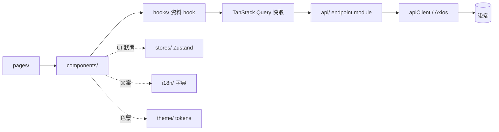

# ARCHITECTURE.md — 架構與理由

> 動工時必守的規則見 [`AGENTS.md`](./AGENTS.md)。本文件說明系統怎麼組成、為什麼這樣設計;
> 團隊通用的規則細節在 [`docs/conventions/`](./docs/conventions/),這裡不重抄。

## 1. 系統概觀

<!-- FILL: 一段話說明這個前端在整體系統中的位置:使用者從哪裡進來、打哪些後端、有沒有登入或 SSO。來源:收件時使用者的回答與 prototype-analysis.md。 -->

```mermaid
flowchart LR
  user[使用者瀏覽器] --> spa[{{PROJECT_NAME}} 前端 SPA]
  spa -->|/api| proxy[反向代理]
  proxy --> backend[後端服務]
```

<!-- FILL: 依實際情況調整上圖(例如登入服務、檔案服務)。不知道的節點保留並在待確認問題中列出。 -->

## 2. 資料流



- 伺服器資料只走 TanStack Query;Zustand 只放 UI 狀態([ADR-0004](./docs/adr/0004-server-state-vs-ui-state.md))
- 讀取以 `useSuspenseQuery` 搭配每個窗格一個 `DataBoundary`([ADR-0005](./docs/adr/0005-suspense-query-and-data-boundary.md))
- 錯誤判讀集中在 `api/apiError.ts`,文案依後端 `code` 查字典([ADR-0006](./docs/adr/0006-api-errors-judged-in-one-place.md)、[ADR-0007](./docs/adr/0007-error-copy-owned-by-frontend.md))

## 3. 目錄與分層

按「層」放檔案,依賴方向由 lint 強制([ADR-0002](./docs/adr/0002-layered-directory-structure.md)、
[ADR-0013](./docs/adr/0013-lint-enforces-layer-boundaries.md))。各資料夾放什麼見
[`docs/conventions/project-structure.md`](./docs/conventions/project-structure.md)。

本專案預計的領域(`components/<domain>/`,依任務單逐一建立;不列骨架的範例 `items/`):

<!-- FILL: 表格:domain 資料夾名稱、對應 CONTEXT.md 的名詞、包含哪些主要元件、對應哪些頁面。來源:prototype-analysis.md 的元件清單。 -->

| domain | 領域名詞 | 主要元件 | 用在哪些頁面 |
| ------ | -------- | -------- | ------------ |

## 4. 畫面、路由與版面

<!-- FILL: 路由樹(用縮排清單或 Mermaid),標出每個路由使用的版面(有沒有側欄)與需要的權限。來源:prototype-analysis.md 的路由樹;必須與 src/constants/routes.ts、navEntries.tsx 一致。 -->

路由模式:<!-- FILL: history 或 hash,一句理由,連到對應 ADR。 -->

選單與路由共用 `src/components/layouts/navEntries.tsx` + `src/app/navPages.tsx`,加入口的步驟見
[`docs/conventions/routing.md`](./docs/conventions/routing.md)。

## 5. 權限

<!-- FILL: 權限矩陣表:角色 × 權限代碼(與 src/constants/permissions.ts 一致),以及權限資料從哪個端點來。來源:prototype-analysis.md 的使用者角色與權限矩陣。若本專案沒有角色區分,寫明「目前只有單一角色」並保留骨架。 -->

前端守衛只影響畫面;真正的權限檢查一定在後端([ADR-0012](./docs/adr/0012-role-based-permission-skeleton.md))。

## 6. 主題

色票唯一來源是 `src/theme/tokens.ts`,逐值取自 prototype([ADR-0001](./docs/adr/0001-visual-authority-is-the-prototype.md))。
同一份表餵給 antd `ConfigProvider` 與 CSS Modules 讀的 `--app-*` 變數。細節見
[`docs/conventions/styling-theme.md`](./docs/conventions/styling-theme.md)。

<!-- FILL: 本專案是否需要深色模式、prototype 有沒有提供深色色票;沒有提供時寫明暫用 antd 預設推導,並列入待確認問題。 -->

## 7. 後端對接與 mock

- 契約唯一來源:[`docs/api/`](./docs/api/);DTO 與後端逐字一致([ADR-0003](./docs/adr/0003-dto-matches-backend-contract.md))
- 後端未上線的端點以 MSW 模擬,上線後從開發期 mock 移除([ADR-0011](./docs/adr/0011-dev-mocks-removed-when-endpoint-ships.md))

<!-- FILL: 目前後端狀態一句話(已有 / 開發中 / 未開始),以及預計上線順序(若已知)。 -->

## 8. 本專案的架構決策

<!-- FILL: 列出本專案自己的 ADR(0017 起),每列一句話摘要與連結。至少有路由模式。 -->
